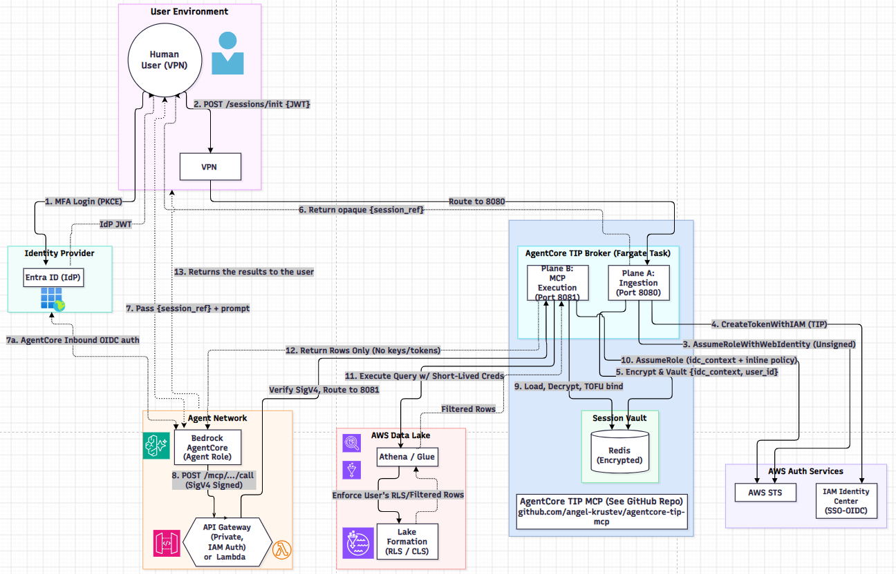

# Lakehouse Claims Agent (MVP Reference Implementation)

A functional, local-VPC Bedrock Agent demonstrating how to securely query enterprise data lakes using the [AgentCore TIP MCP Broker](https://github.com/angel-krustev/agentcore-tip-mcp).

> ⚠️ **Architecture Notice: MVP vs. Production**
> This repository provides an MVP implementation using AWS Cloud Map and raw Fargate for local VPC testing. It does **not** include the private API Gateway and IAM Auth required for production-grade Machine-to-Machine (M2M) Zero-Trust. 
>
> For deploying this agent into strict enterprise compliance environments (SOC2, HIPAA), you must implement the API Gateway / mTLS architecture detailed in the main broker repository. 
> 
> *If your team requires assistance upgrading this MVP to a production enterprise architecture, please contact me for consulting.*

## Overview

This MVP implements a **Secure Insurance Claims Copilot** — a Streamlit-powered conversational AI that lets users query insurance claims data in an AWS data lake through natural language, with row- and column-level security enforced natively by **AWS Lake Formation**.

### Architecture Flow



1. **MFA login:** The user signs in to Entra ID with PKCE and receives an identity-provider JWT.
2. **Initialize the session:** The app posts the JWT to `/sessions/init` through the VPN .
3. **Assume the web identity:** The broker uses the identity-provider token with AWS STS `AssumeRoleWithWebIdentity` to establish the user's AWS identity.
4. **Create the TIP token:** The broker calls `CreateTokenWithIAM` to obtain the Trusted Identity Propagation (TIP) token.
5. **Encrypt and vault the session context:** The broker encrypts and stores the identity-center context and user ID in the session vault.
6. **Return the opaque session reference:** The broker returns `session_ref` to the user environment; the JWT is not passed to the agent.
7. **Send the prompt to the agent:** The user environment passes `session_ref` and the prompt to the Bedrock AgentCore agent.

   **7a. Authenticate inbound to AgentCore:** AgentCore performs inbound OIDC authentication for the agent request. **Recommendation:** use a different audience for AgentCore than for PEP session initialization, even when both are for the same app.
8. **Call the MCP endpoint:** The agent sends a SigV4-signed MCP request. The broker verifies the signature and routes it to Plane B on port 8081.
9. **Load and bind the session:** Plane B loads and decrypts the session data from the encrypted Redis vault, then performs the TOFU bind.
10. **Assume the scoped role:** The broker assumes an AWS role using the identity-center context and inline policy.
11. **Execute the query:** The broker queries Athena/Glue using short-lived credentials. Lake Formation enforces the user's row-level security and filters.
12. **Return authorized rows:** Only filtered rows, without keys or tokens, are returned from the data layer.
13. **Return results to the user:** The results are returned to the user environment.

### Key Security Properties

| Property | How It's Achieved |
|----------|-------------------|
| **Zero-Trust Authentication** | Entra ID via MSAL PKCE — no client secrets stored |
| **Token Blindness** | Bedrock Agent never sees the user's JWT; only an opaque `session_ref` |
| **Air-Gapped Plane B** | Plane B (port 8081) is never exposed to the ALB or internet; only the API GW or/and the Lambda proxy reaches it |
| **Row/Column Security** | Enforced natively by AWS Lake Formation — no Python-side filtering |
| **Identity Propagation** | AWS Trusted Identity Propagation (TIP) handled by the PEP — no STS `AssumeRole` in app code |

## Setup Instructions

### Prerequisites

- **AWS CLI** configured for your target account and region (`us-east-1`)
- **Docker** with `buildx` (for building `linux/arm64` images)
- **Python 3.10+** with `pip`
- **AWS CloudFormation** CLI or Console
- **Terraform** 1.6+ (if using the Terraform IaC path)
- **Entra ID** tenant with a registered public client application (redirect URI: `http://localhost:8501/`)

### Step 1 — Configure Environment Variables

```bash
cp .env.example .env
```

Edit `.env` with your Entra ID credentials, PEP Plane A URL, and Bedrock Agent ARN:

| Variable | Description |
|----------|-------------|
| `ENTRA_CLIENT_ID` | Your Entra ID application (client) ID |
| `ENTRA_TENANT_ID` | Your Entra ID tenant ID |
| `ENTRA_AUTHORITY` | (Optional) Custom authority URL; defaults to `https://login.microsoftonline.com/<tenant>` |
| `PEP_PLANE_A_URL` | HTTPS URL of the ALB-facing PEP Plane A (e.g., `https://pep-plane-a.internal.example.com`) |
| `BEDROCK_AGENT_ID` | Full AgentCore Runtime ARN (e.g., `arn:aws:bedrock-agentcore:us-east-1:<account>:runtime/<name>-<id>`) |

If using a self-signed ALB certificate, set the shell environment variable:
```bash
export PEP_CA_BUNDLE=cert/cert.pem
```

### Step 2 — Deploy the Identity Stack

The identity stack creates the three IAM roles required by the PEP (OIDC, carrier, and service roles).

**CloudFormation:**
```bash
aws cloudformation create-stack --stack-name identity --region us-east-1 \
  --template-body file://iam/identity-stack.yml --capabilities CAPABILITY_NAMED_IAM \
  --parameters \
    ParameterKey=OidcProviderArn,ParameterValue=arn:aws:iam::<acct>:oidc-provider/login.microsoftonline.com/<tenant>/v2.0 \
    ParameterKey=OidcAudiences,ParameterValue="<client-id-1>,<client-id-2>"
```

**Terraform** (integrated in root `main.tf` — no separate step needed).

### Step 3 — Deploy the Network Stack (CloudFormation only)

```bash
aws cloudformation create-stack --stack-name claims-copilot-network --region us-east-1 \
  --template-body file://template-network.yaml \
  --parameters \
    ParameterKey=VpcId,ParameterValue="<your-vpc-id>" \
    ParameterKey=NatSubnetId,ParameterValue="<nat-subnet-id>" \
    ParameterKey=PrivateSubnetCidrs,ParameterValue="<cidr-1>,<cidr-2>" \
    ParameterKey=PrivateSubnetAzIds,ParameterValue="<az-1>,<az-2>" \
    ParameterKey=VpnOrStreamlitCidr,ParameterValue="<vpn-cidr>" \
    ParameterKey=VpnSecurityGroupId,ParameterValue="<vpn-sg-id-or-empty>"
```

### Step 4 — Build and Push the Agent Image

```bash
# Windows (PowerShell)
.\scripts\deploy-agent-image.ps1 -Tag v0.1.0

# Linux/macOS
bash scripts/deploy-agent-image.sh -t v0.1.0
```

This builds the `linux/arm64` image for the AgentCore Runtime agent and pushes it to ECR.

### Step 5 — Deploy the App Stack

**CloudFormation:**
```bash
aws cloudformation create-stack --stack-name lakehouse-claims-agent-mvp --region us-east-1 \
  --template-body file://template.yaml --capabilities CAPABILITY_NAMED_IAM \
  --parameters \
    ParameterKey=IdentityStackName,ParameterValue="<identity-stack-name>" \
    ParameterKey=NetworkStackName,ParameterValue="<network-stack-name>" \
    ParameterKey=InternalCertificateArn,ParameterValue="<acm-certificate-arn>" \
    ParameterKey=PepContainerImage,ParameterValue="<pep-image-uri>" \
    ParameterKey=EntraTenantId,ParameterValue="<your-tenant-id>" \
    ParameterKey=EntraClientId,ParameterValue="<your-client-id>" \
    ParameterKey=SsoApplicationArn,ParameterValue="<sso-application-arn>" \
    ParameterKey=AthenaWorkGroup,ParameterValue="<athena-workgroup>" \
    ParameterKey=AthenaDatabaseName,ParameterValue="<athena-database>" \
    ParameterKey=AgentRepositoryName,ParameterValue="<ecr-repo-name>" \
    ParameterKey=AgentImageTag,ParameterValue="<agent-image-tag>" \
    ParameterKey=ModelId,ParameterValue="<bedrock-model-id>" \
    ParameterKey=ModelMaxTokens,ParameterValue="<max-tokens>" \
    ParameterKey=ServiceDiscoveryDomain,ParameterValue="<service-discovery-domain>" \
    ParameterKey=PepDesiredCount,ParameterValue="<pep-task-count>" \
    ParameterKey=DeployAgentRuntime,ParameterValue=true
```

**Terraform:**
```bash
terraform init
terraform apply \
  -var 'identity_stack_name=<identity-stack-name>' \
  -var 'network_stack_name=<network-stack-name>' \
  -var 'internal_certificate_arn=<acm-certificate-arn>' \
  -var 'pep_container_image=<pep-image-uri>' \
  -var 'entra_tenant_id=<your-tenant-id>' \
  -var 'entra_client_id=<your-client-id>' \
  -var 'sso_application_arn=<sso-application-arn>' \
  -var 'athena_workgroup=<athena-workgroup>' \
  -var 'athena_database_name=<athena-database>' \
  -var 'agent_repository_name=<ecr-repo-name>' \
  -var 'agent_image_tag=<agent-image-tag>' \
  -var 'model_id=<bedrock-model-id>' \
  -var 'service_discovery_domain=<service-discovery-domain>' \
  -var 'deploy_agent_runtime=true'
```

#### Required Parameters

| Parameter | Description | Example |
|-----------|-------------|---------|
| `IdentityStackName` | Name of the deployed identity stack | `vt-identity` |
| `NetworkStackName` | Name of the deployed network stack | `claims-copilot-network` |
| `InternalCertificateArn` | ACM certificate ARN for the ALB | `arn:aws:acm:us-east-1:...` |
| `PepContainerImage` | ECR URI of the PEP container image | `123456789.dkr.ecr.us-east-1.amazonaws.com/pep:v1.0` |
| `EntraTenantId` | Entra ID tenant GUID | `<tenant-guid>` |
| `EntraClientId` | Entra ID client GUID | `<client-guid>` |
| `SsoApplicationArn` | IAM Identity Center application ARN | `arn:aws:sso:...` |
| `AthenaWorkGroup` | Athena workgroup name | `idc-wg` |
| `AthenaDatabaseName` | Athena database name | `insurance_analytics` |
| `AgentRepositoryName` | ECR repository name for the agent image | `lakehouse-claims-agent-mvp` |
| `AgentImageTag` | Tag of the agent image | `v0.2.0` |
| `ModelId` | Bedrock model ID | `us.anthropic.claude-sonnet-4-6` |
| `ModelMaxTokens` | Maximum output tokens | `4096` |
| `ServiceDiscoveryDomain` | Private DNS domain for Plane B | `claims-copilot.internal` |
| `PepDesiredCount` | Number of PEP tasks (keep 1 for MVP) | `1` |
| `DeployAgentRuntime` | Whether to create the AgentCore Runtime | `true` / `false` |

#### Network Stack Parameters

| Parameter | Description | Example |
|-----------|-------------|---------|
| `VpcId` | VPC ID | `vpc-xxxxxxxx` |
| `NatSubnetId` | Public subnet for the NAT gateway | `subnet-xxxxxxxx` |
| `PrivateSubnetCidrs` | Two CIDR blocks for private subnets | `172.31.96.0/20,172.31.112.0/20` |
| `PrivateSubnetAzIds` | Two AZ IDs for private subnets | `use1-az2,use1-az4` |
| `VpnOrStreamlitCidr` | CIDR allowed to reach the ALB | `10.0.0.0/16` |
| `VpnSecurityGroupId` | VPN gateway security group (optional) | `sg-xxxxxxxx` or empty |

### Step 6 — Run the Streamlit App

```bash
pip install -r requirements.txt
streamlit run app.py
```

Navigate to `http://localhost:8501` in your browser. You will be redirected to your Entra ID login page. After authentication, the copilot chat interface will appear.

### Example Queries

Once logged in, try asking:

- *"Show me the top 5 claims with the highest fraud risk score"*
- *"Which tables can I query?"*
- *"Total claim payments by payment type"*

## Project Structure

| Path | Description |
|------|-------------|
| `app.py` | Streamlit frontend — Entra ID login, chat UI, Bedrock Agent invocation |
| `agent_runtime/` | AgentCore Runtime agent Docker image (SQL generation + tool use) |
| `lambda/pep_proxy.py` | Lambda proxy between the Bedrock Agent and PEP Plane B |
| `iam/` | Identity stack (CloudFormation + Terraform) — OIDC, carrier, and PEP service roles |
| `network/` | VPC, subnets, NAT gateway, and security groups (Terraform module) |
| `template.yaml` | CloudFormation app stack (PEP, ALB, Bedrock Agent, Lambda proxy) |
| `template-network.yaml` | CloudFormation network stack |
| `main.tf` | Terraform app stack (equivalent of `template.yaml`) |
| `scripts/` | Agent image build and push scripts (bash and PowerShell) |
| `data/` | Athena DDL for the `insurance_analytics` database tables |

## Data Schema

The agent queries the `insurance_analytics` Athena database, which contains:

| Table | Description |
|-------|-------------|
| `insurance_claims_enriched` | Claims with fraud risk scores, policy details, and claimant information |
| `claim_payments` | Payment records linked to claims |

DDL files are in `data/insurance_athena_ddl/`.

## License

Copyright 2026 Angel Krustev / VerticalTurn Inc.

Licensed under the Apache License, Version 2.0 — see [LICENSE](LICENSE).
